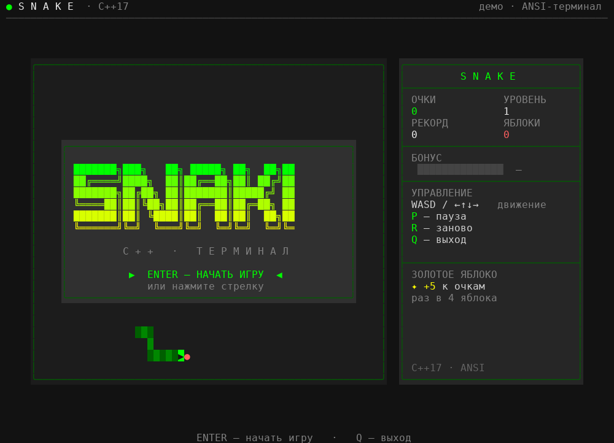
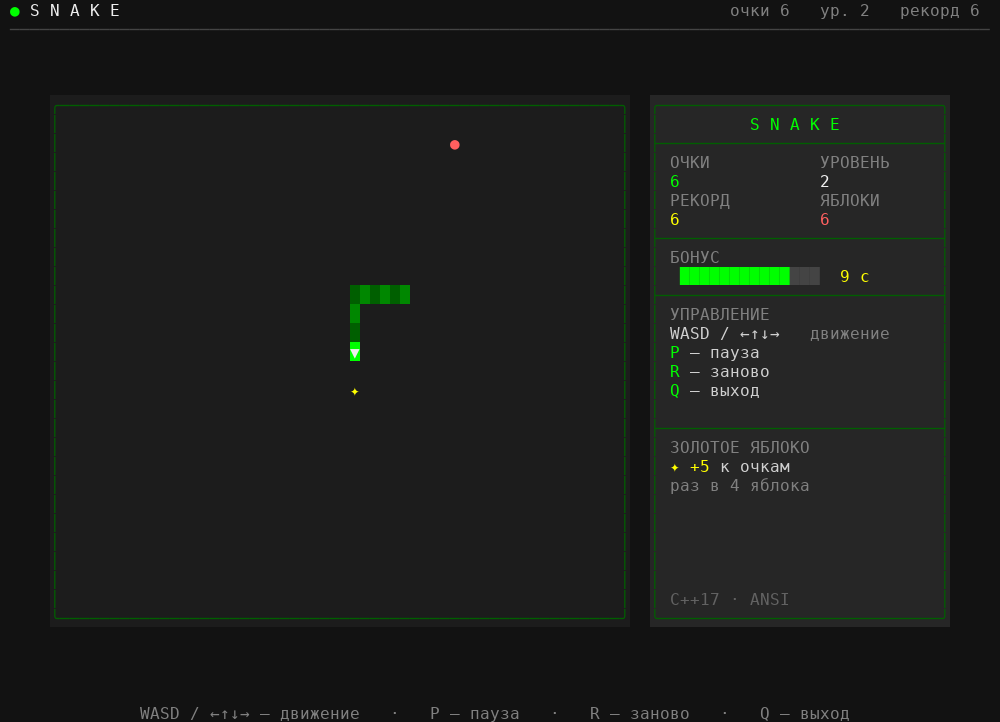
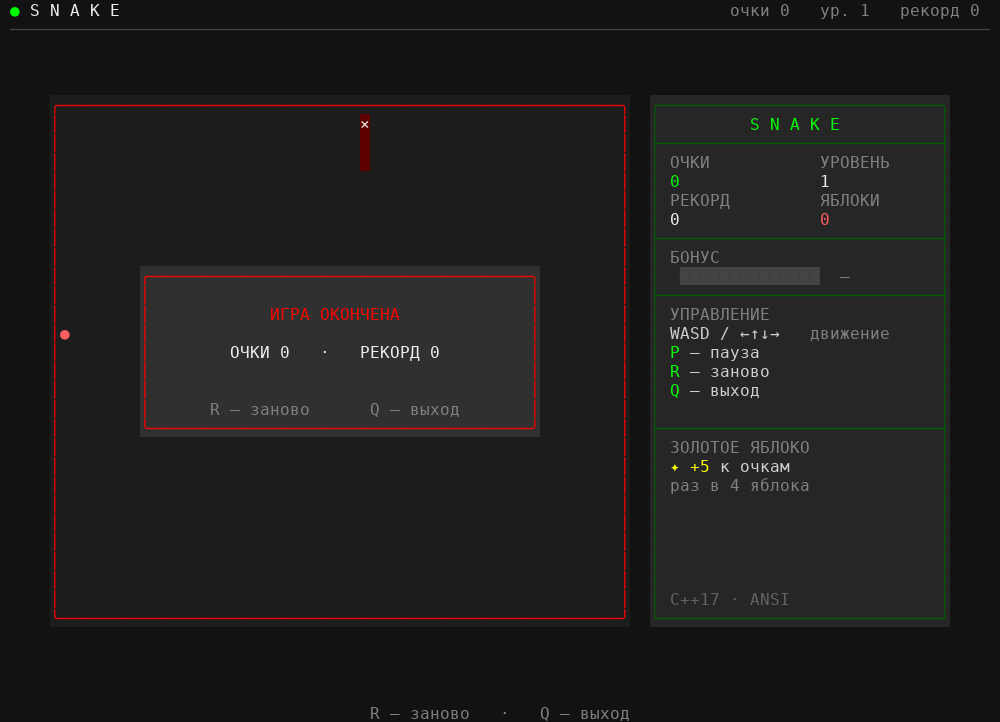

# SNAKE · C++17

Лёгкая терминальная аркада «Змейка» на C++17: без фреймворков и без внешних зависимостей —
только стандартная библиотека и ANSI-последовательности. Играть можно прямо в терминале или
в браузере (C++-процесс запускается на сервере, браузер выступает в роли терминала).



| Игра | Конец игры |
| --- | --- |
|  |  |

## Возможности

- плавное управление змейкой с очередью нажатий — быстрые повороты не теряются;
- 6+ уровней скорости: каждые 5 очков змейка ускоряется;
- золотое яблоко `✦` — появляется раз в 4 яблока, живёт ограниченное время и даёт +5 очков;
- пауза, рестарт, счёт, рекорд за сеанс;
- аккуратный интерфейс: рамки, панель статистики, заставка с анимированной демо-змейкой,
  плашка нового уровня и экран окончания игры;
- адаптивная вёрстка под размер терминала: от 40×18 до широких экранов;
- тесты игровой логики и браузерная версия с сенсорным управлением.

## Управление

| Клавиши | Действие |
| --- | --- |
| `W` `A` `S` `D` / стрелки | движение (работает и русская раскладка: `ц` `ф` `ы` `в`) |
| `P` | пауза |
| `R` | начать заново |
| `Q` | выход |
| `Enter` | начать игру / убрать оверлей |

## Сборка и запуск

Нужен только компилятор с поддержкой C++17 (g++ или clang++) и make.

```bash
make          # соберёт build/snake-ui
make run      # запустить игру в терминале
make test     # тесты игровой логики
```

Запуск без make:

```bash
g++ -std=c++17 -O2 -Isrc src/*.cpp -o snake && ./snake
```

### Ключи командной строки

```text
--size WxH        размер виртуального экрана (для браузерного режима)
--seed N          зерно генератора случайных чисел
--dump [title|game]  напечатать кадр обычным текстом и выйти
--ansi            с --dump: печатать полный ANSI-кадр с цветами
--dump-ticks N    сколько тиков сыграть перед --dump game
-h, --help        справка
```

Пример: `./build/snake-ui --size 100x38 --seed 7 --dump game --dump-ticks 18` — текстовый снимок
кадра с изогнутой змейкой (используется в `make check-ui`).

## Версия для браузера

```
make && make serve     # http://localhost:8080
```

Устроено так: `web/server.js` (Node.js, без npm-зависимостей) запускает для каждой сессии
отдельный процесс `build/snake-ui`, стримит его вывод в браузер через SSE, а нажатия клавиш
передаёт обратно в stdin процесса. Если прокси буферизует SSE, клиент автоматически
переключается на поллинг — игра работает в любых условиях. Рисует всё это xterm.js
(файлы лежат в `web/public/vendor`, лицензия MIT).

Сервер сам соберёт бинарник, если его нет, и завершит зависшие сессии.

## Структура

```
src/game.*      чистая игровая логика (поле, змейка, бонусы, уровни) — без ввода-вывода
src/screen.*    экранный буфер: сетка ячеек с цветом → ANSI или обычный текст
src/term.*      терминал: сырой режим, неблокирующие клавиши, размер окна
src/app.*       состояния, ввод, анимация и отрисовка экранов
src/main.cpp    разбор аргументов и точка входа
tests/          тесты игрового ядра (make test)
web/            браузерная версия: сервер на Node.js и фронтенд
docs/           скриншоты
```

Игровое ядро ничего не знает про терминал: `snake::Game` можно тестировать и использовать
в другом интерфейсе.

## Тесты

```bash
make test      # 28 проверок: движение, повороты, столкновения, бонусы, уровни, reset, детерминизм
make check-ui  # дымовой тест отрисовки
```

## Лицензия

Код игры — MIT. xterm.js и addon-fit распространяются по лицензии MIT (см. файлы
`web/public/vendor/*.LICENSE`).
